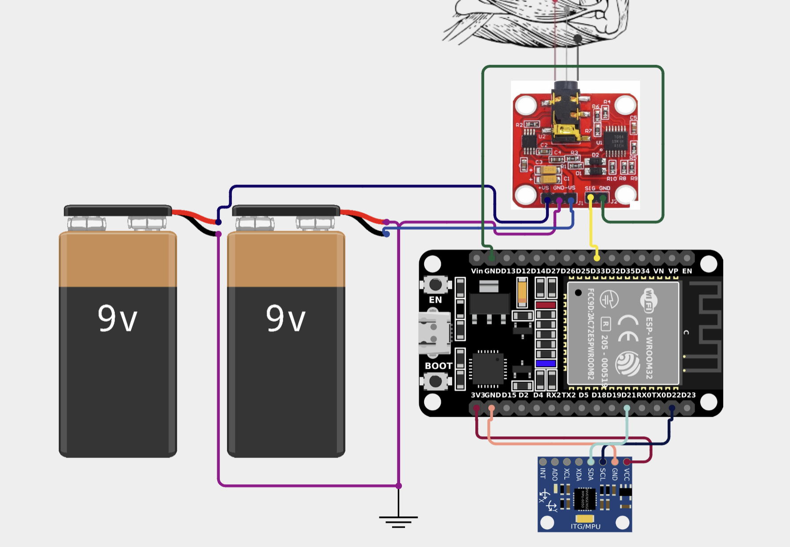

# Kinesis: Edge AI Physiotherapy Assistant

A wearable that checks rehabilitation exercise form in real time. An ESP32 fuses IMU and EMG signals and runs an on-device neural network that labels each movement as **good form**, **bad form** or **rest**.


---

## Overview

Physiotherapy patients usually do their exercises at home, with no one to tell them when their form slips. Kinesis gives that feedback on the spot. A forearm-mounted unit reads wrist motion and muscle activation and classifies each repetition locally on the microcontroller, with no cloud and no phone.

| Class | Meaning |
|---|---|
| ✅ `good_form` | Exercise performed correctly |
| ❌ `bad_form` | Incorrect movement pattern detected |
| 💤 `rest` | No exercise in progress |

### Scope

The original concept was a **full-body suit** with several IMUs and EMG channels covering the shoulder, knee and spine. To prove the idea within the project timeline, the prototype was scoped down to one joint: **wrist curls**, a common rehabilitation and strength exercise. The pipeline is the same one a multi-sensor version would use.

## Hardware

<p align="center"></p>

| Component | Role | Connection |
|---|---|---|
| ESP32 DevKitC (ESP-WROOM-32) | MCU, runs inference | — |
| MPU6050 | 3-axis accelerometer + gyroscope | I²C (SDA/SCL) |
| EMG sensor module | Forearm muscle activation | Analog → GPIO 33 |
| 2 × 9 V batteries | Split ± supply for the EMG front-end | +Vs / GND / −Vs |

The full bill of materials is in [`hardware/BOM.xlsx`](hardware/BOM.xlsx).

## ML Pipeline

```
 MPU6050 (accel + gyro, ~43 Hz) ─┐
                                 ├─► Spectral features (FFT-16, log) ─► Dense NN ─► good_form / bad_form / rest
 EMG @ ~1 kHz → RMS, MAV, WL ────┘
```

**Data collection.** About 4 minutes per class (3 min train / 1 min test), streamed with the Edge Impulse Data Forwarder from [`firmware/data_collection`](firmware/data_collection).

**Feature extraction (Edge Impulse spectral analysis).** FFT length 16, log spectrum, overlapping frames, improved low-frequency resolution, no filter, decimation 1.

**Model.**

| Layer | Config |
|---|---|
| Input | ~100–150 spectral features |
| Dense | 32, ReLU |
| Dense | 16, ReLU |
| Output | 3, Softmax |

Adam optimiser, dropout 0.2, ~40 epochs, batch size 16. The target accuracy for the demo was 85–95 %.

## Repository Structure

```
.
├── firmware/
│   ├── data_collection/     Streams IMU + EMG features to the Edge Impulse Data Forwarder
│   └── inference/           On-device classification with the exported Edge Impulse library
├── hardware/
│   ├── schematic.png        Wiring diagram
│   └── BOM.xlsx             Bill of materials
└── docs/
    ├── report.docx          Project report
    ├── presentation.pptx    Slides
    └── notes/               Process notes and Data Forwarder setup
```

## Getting Started

1. **Install** the Arduino IDE with the ESP32 board package, plus the `Adafruit MPU6050` and `Adafruit Unified Sensor` libraries.
2. **Collect data.** Flash `firmware/data_collection`, then run:
   ```sh
   edge-impulse-data-forwarder --frequency 43
   ```
   Record samples for each label.
3. **Train** the impulse in Edge Impulse using the settings above.
4. **Export** the model as an **Arduino library** and add the ZIP in the Arduino IDE (*Sketch → Include Library → Add .ZIP Library*).
   The trained model is not included in this repo. In `firmware/inference/inference.ino`, change `#include <TBD_inferencing.h>` to `<your-project-name>_inferencing.h`.
5. **Deploy.** Flash `firmware/inference` and open the Serial Monitor at **115200 baud** to see per-class confidence scores.

Memory budget on the target: about 320 KB RAM and 4 MB flash.

## Roadmap

- More IMU/EMG nodes for shoulder, knee and back exercises
- A BLE companion app for feedback and progress tracking
- Per-patient calibration and repetition counting

## License

Released under the [MIT License](LICENSE).

## Contact

**Dousik Manokaran**: [m.dousik@gmail.com](mailto:m.dousik@gmail.com) · [LinkedIn](https://www.linkedin.com/in/dousikmanokaran/)
